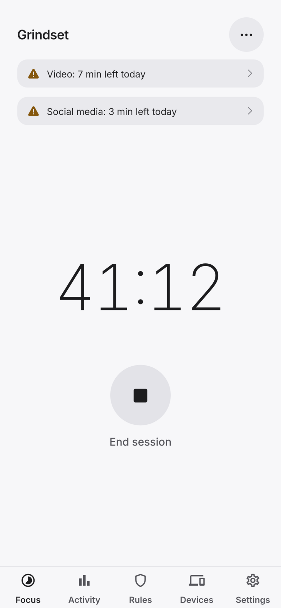
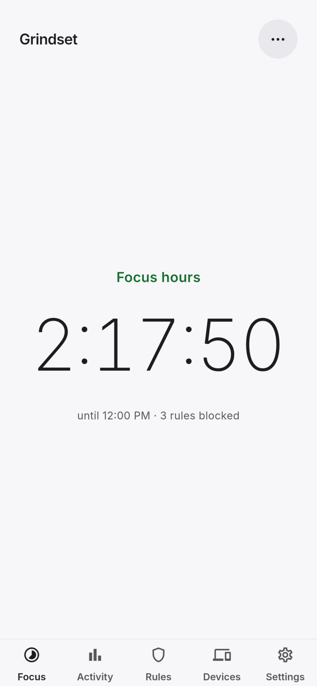
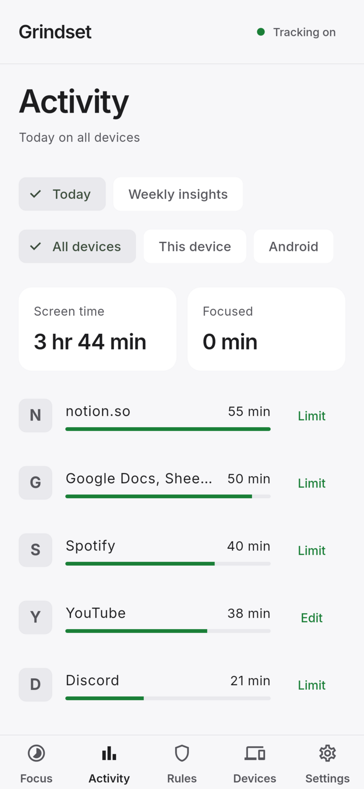
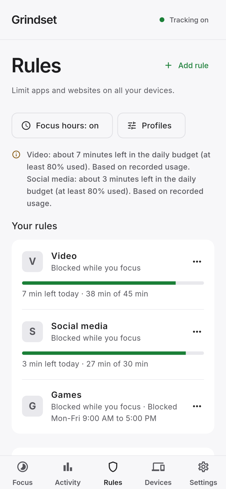
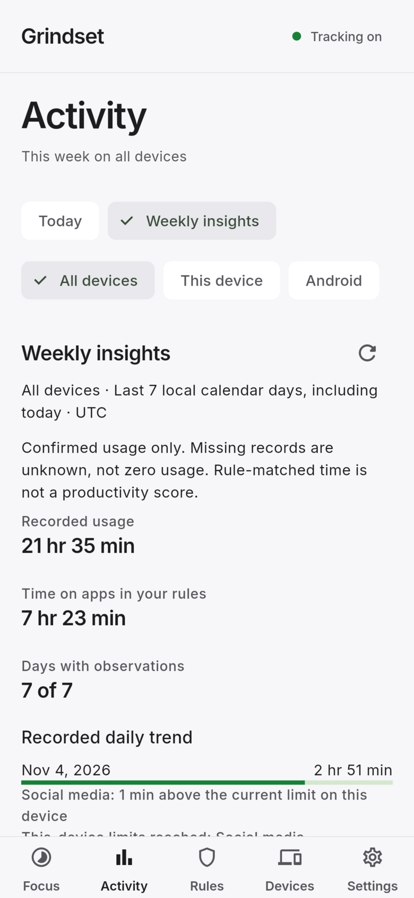
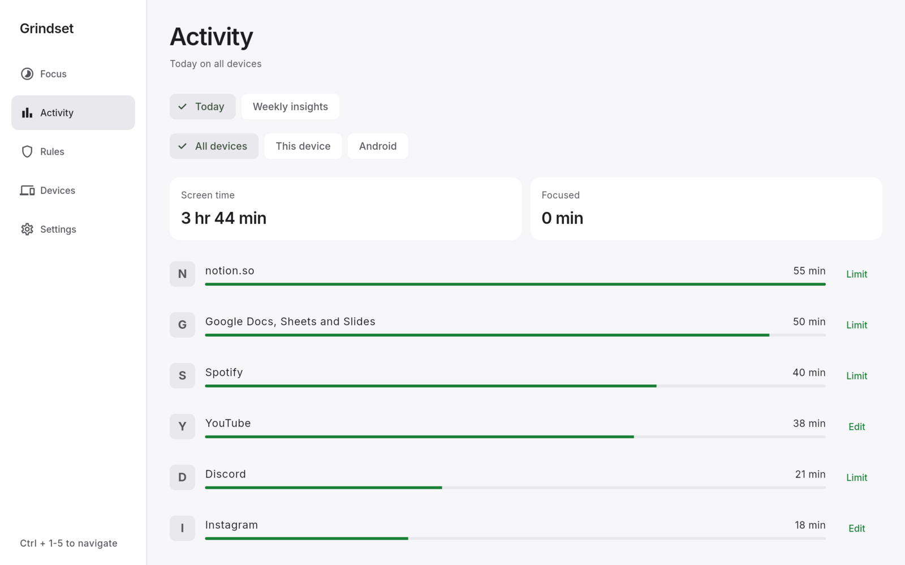

  

<h1 align="center">Grindset</h1>

  <b>Less scrolling, more done.</b> 
  Block distracting apps and websites on your phone and PC, with one set of rules for both.

  <a href="https://github.com/danarrigo/grindset-releases/releases/latest"><b>Download the latest release</b></a>
  ·
  <a href="https://addons.mozilla.org/en-US/firefox/addon/grindset-for-windows/">Firefox / Zen extension</a>
  ·
  <a href="https://danarrigo.github.io/grindset-releases/">Website</a>

  
  
  
  
  

## What it does

| | |
|---|---|
| **Lock in** | Start a focus session and distractions are blocked until it ends. |
| **Daily limits** | Give an app or site a daily allowance, like 30 minutes of YouTube. Once it's used up, it's blocked until tomorrow. |
| **Focus hours** | Block distractions automatically at set times, like your work or study hours. No timer needed. |
| **One set of rules everywhere** | Sign in and your rules, limits and Focus hours apply on your phone and PC. Time spent on the YouTube app and on youtube.com counts toward the same limit. |
| **Activity** | See where your time went today and this week, on one device or all of them together. |
| **Strict mode** | While blocking is on, rules can only get stricter, so you can't quietly turn them off. |

  

## Install

| Platform | File | Notes |
|---|---|---|
| **Android** | `grindset-<version>-android-arm64.apk` | Open the file to install. Grindset asks for Usage access and permission to show its block screen. |
| **Windows** | `grindset-<version>-windows-x64-setup.exe` | Installs for your user only and starts with Windows. A portable `.zip` is also available. |
| **Browser** | [Firefox / Zen add-on](https://addons.mozilla.org/en-US/firefox/addon/grindset-for-windows/) | Lets Grindset on Windows see and block websites. Pair it with the code shown in the app. |

All files are on the [latest release](https://github.com/danarrigo/grindset-releases/releases/latest), with `SHA256SUMS.txt` to check them. Grindset checks for updates by itself and tells you when a new version is out.

**Updating:** install the new version over the old one. Your rules and history are kept. Don't uninstall first.

**Windows warning:** the installer isn't code-signed yet, so Windows SmartScreen may warn you. Choose *More info → Run anyway*. Never turn off your antivirus or other security settings to install it.

## Privacy

Grindset records which app or site is open and for how long, and nothing else. It never sees your screen, what you type, or page contents. Without an account, everything stays on your device. With an account, your rules and usage times sync between your devices. See the [privacy policy](https://danarrigo.github.io/grindset-releases/privacy/).

This website uses no analytics or cookies. You can [delete your account](https://danarrigo.github.io/grindset-releases/delete-account/) at any time.

---

Grindset is a personal project in preview. This repository holds the public downloads, the update feed and the small website; the app's source code is private. Each release lists its changes and known limitations.
